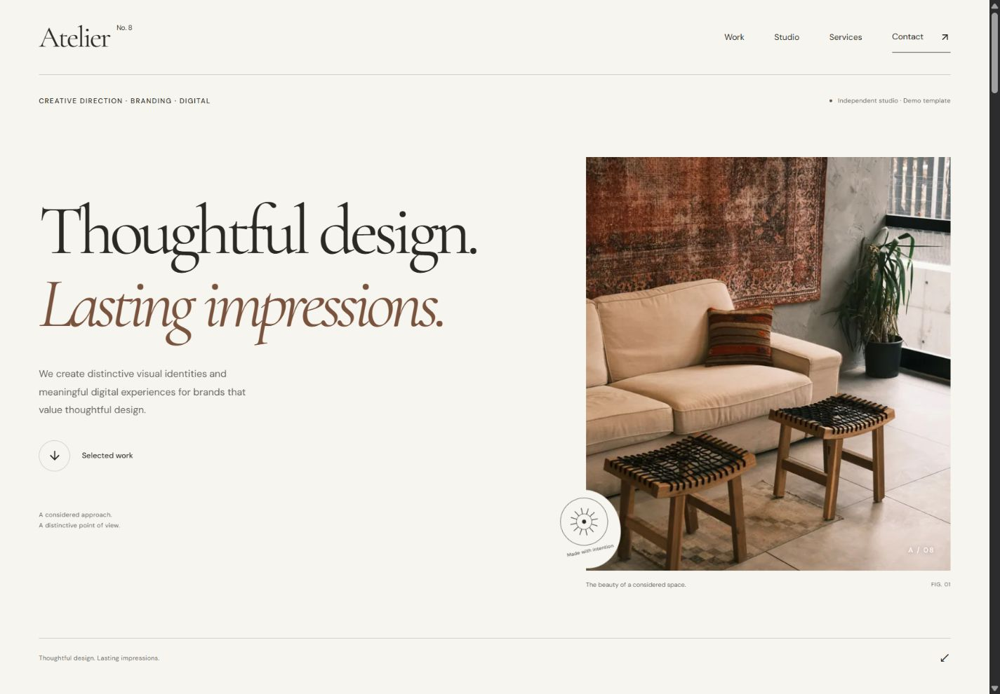

# Atelier No. 8

An editorial portfolio template for creative studios, built with React and TypeScript. All featured brands and projects are fictional concepts.



[Mobile preview](qa/release-mobile.jpg) · [Customization](CUSTOMIZATION_GUIDE.md) · [Deployment](DEPLOYMENT_GUIDE.md) · [Release report](PRODUCTION_RELEASE_REPORT.md)

## Features

- Responsive gallery, category filters and accessible native project dialogs.
- Mobile navigation, expandable services and reduced-motion-aware animation.
- Typed brand, theme, copy, project, SEO and section configuration.
- Honest demo enquiry validation and optional configured email drafting.
- Local responsive WebP images, licensed fonts and static head metadata.
- Nord Studio configuration example using the same application.

**Stack:** React 19, TypeScript 6, Vite 8, Tailwind CSS 4 and Lucide. ESLint, Prettier and Node's test runner provide validation. Dependencies are locked in `package-lock.json`.

## Local development

Use Node 22.19+ (Node 22 LTS is the configured build line) and npm. In the directory containing `package.json`:

```sh
git clone https://github.com/monExcalibur/atelier-no8-template.git
cd atelier-no8-template
npm ci
npm run dev
```

Open [localhost:4194](http://127.0.0.1:4194/). Use `-- --port 4195` if that strict port is occupied. Preview over HTTP rather than opening `index.html` directly.

| Command | Purpose |
| --- | --- |
| `npm run dev` | Development server |
| `npm run typecheck` | Strict TypeScript check |
| `npm run lint` | ESLint |
| `npm test` | Configuration, contact, assets, metadata and deployment contracts |
| `npm run format:check` | Formatting check (`npm run format` applies it) |
| `npm run audit:publication` | Credential-pattern and local-asset audit |
| `npm run build` | Portable local production build in `dist/` |
| `npm run build:github` | Repository-subpath production build |
| `npm run build:cloudflare` | Root-hosted Cloudflare production build |
| `npm run preview` | Inspect the built site locally |

## Deployment

Both production demonstrations are published and verified over HTTPS on 2026-10-24:

| Destination | Public address |
| --- | --- |
| Source repository | [atelier-no8-template](https://github.com/monExcalibur/atelier-no8-template) |
| GitHub Pages | [https://monexcalibur.github.io/atelier-no8-template/](https://monexcalibur.github.io/atelier-no8-template/) |
| Cloudflare Pages | [https://atelier-no8-template.pages.dev/](https://atelier-no8-template.pages.dev/) |

A push to `main` automatically triggers both platforms from the same source commit. GitHub Actions runs `npm run build:github` with repository base `/atelier-no8-template/`; native Cloudflare Pages Git integration runs `npm run build:cloudflare` with root base `/`. Each platform publishes its own `dist` build and stable canonical URL. The GitHub owner/repository are derived from Actions metadata or the Git remote, not hardcoded in the build script.

[DEPLOYMENT_GUIDE.md](DEPLOYMENT_GUIDE.md) covers updates, public build settings, monitoring, verification, custom domains and rollback. [DEPLOYMENT_EXECUTION_PLAN.md](DEPLOYMENT_EXECUTION_PLAN.md) and [qa/live-deployment-checks.json](qa/live-deployment-checks.json) record the deployment checks. Historical release reports describe their original local verification date; this section supersedes their pre-publication hosting status.

## Customization

Edit `src/config/siteConfig.ts` for branding, contact, demo mode, SEO and section flags; `content.ts` for copy; `theme.ts` for design tokens; `projects.ts` for project data. Replace licensed images/fonts in `public/`. Full field-level instructions and the Nord example are in [CUSTOMIZATION_GUIDE.md](CUSTOMIZATION_GUIDE.md).

Copy `.env.example` to ignored `.env.local` for local public build inputs. Never put secrets in `VITE_*`; they become part of the public build. Disabled sections automatically remove their navigation and dependent CTAs.

`npm run assets:prepare` deliberately regenerates the supplied demo imagery/fonts from their registered sources. It needs network access and replaces those files; ordinary builds use the included local assets.

## Demo limitations

Demo mode is enabled and every fictional project retains a concept label. The form validates locally and states that nothing was sent or stored. Turning demo mode off does not add a backend or create real client work. Optional `mailto` drafting requires a real configured recipient and the visitor's email application; reliable online delivery requires a separate service.

Navigation uses one-page anchors. Project dialogs have no independent routes, shareable project URLs or per-project SEO. The body requires JavaScript; metadata is rendered into the built HTML. Default fonts use an English subset. No CMS, analytics, database or paid API is included.

## Screenshots and verification

Build and preview, allow fonts/images/animations to settle, then capture 1440×1000 desktop and 375×900 mobile views with closed menus/dialogs and empty form fields. Save screenshots in `qa/` and update the preview links after customization. Review all sections at 320, 375, 768, 1024, 1440 and 1920px.

[PRODUCTION_RELEASE_REPORT.md](PRODUCTION_RELEASE_REPORT.md) records this release's executed checks and limits. Earlier plans and QA remain as dated records; they are not claims about later client editions. Internal plans/raw QA can be omitted from a separate public presentation if desired, while retaining them locally and preserving working documentation links.

## License and attribution

See [ASSET_LICENSES.md](ASSET_LICENSES.md) and the site's image credits for Pexels photography, OFL fonts and ISC icons. Required notices remain included. Those licenses do not license the application source; choose an appropriate source-code license before offering redistribution. Concept imagery is not represented as commissioned work.

Portfolio description: “Atelier No. 8 is a responsive creative studio portfolio template with an editorial visual system, accessible project dialogs and typed customization. All featured projects are fictional concepts.”
